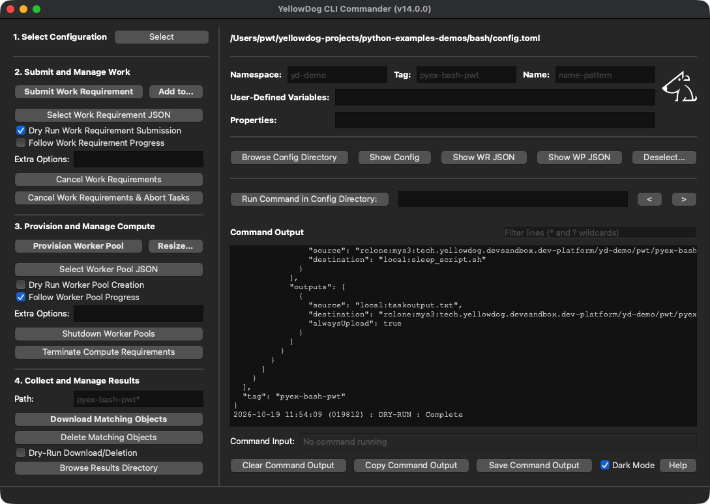

# YellowDog Commander

<!--ts-->
   * [Overview](#overview)
   * [Installation](#installation)
   * [Running](#running)
      * [Launch Details](#launch-details)
   * [How It Works](#how-it-works)
      * [Command Details](#command-details)
   * [Objects and the Data Client](#objects-and-the-data-client)
      * [Data Client Details](#data-client-details)
   * [Quitting](#quitting)
   * [Naming and Matching Assumptions](#naming-and-matching-assumptions)
      * [Matching by Name](#matching-by-name)
      * [Matching Pitfalls](#matching-pitfalls)
      * [Object Naming and Matching](#object-naming-and-matching)
         * [Object Path Details](#object-path-details)
   * [File Dialogs](#file-dialogs)
      * [File Dialog Details](#file-dialog-details)
   * [Selecting a Configuration (Panel 1)](#selecting-a-configuration-panel-1)
   * [Submitting and Managing Work (Panel 2)](#submitting-and-managing-work-panel-2)
      * [Adding to a Work Requirement](#adding-to-a-work-requirement)
         * [Add To Details](#add-to-details)
   * [Provisioning and Managing Compute (Panel 3)](#provisioning-and-managing-compute-panel-3)
      * [Resizing a Worker Pool](#resizing-a-worker-pool)
         * [Resize Details](#resize-details)
   * [Collecting and Managing Results (Panel 4)](#collecting-and-managing-results-panel-4)
      * [Dry Runs and the Selection Dialogs](#dry-runs-and-the-selection-dialogs)
      * [Results Details](#results-details)
   * [Namespace, Tag, and Name Overrides](#namespace-tag-and-name-overrides)
      * [How the Placeholders Are Read](#how-the-placeholders-are-read)
   * [User-Defined Variables](#user-defined-variables)
   * [Properties](#properties)
      * [Properties Details](#properties-details)
   * [Quoting](#quoting)
   * [Utility Actions](#utility-actions)
      * [Utility Action Details](#utility-action-details)
   * [Filtering the Command Output](#filtering-the-command-output)
      * [Filtering by Process](#filtering-by-process)
      * [Filtering by Text](#filtering-by-text)
      * [Copying and Saving Filtered Output](#copying-and-saving-filtered-output)
   * [Running Arbitrary Commands](#running-arbitrary-commands)
      * [How Typed Commands Are Run](#how-typed-commands-are-run)
   * [Sending Input to a Running Command](#sending-input-to-a-running-command)
   * [A Note on Confirmations](#a-note-on-confirmations)
      * [Choosers and Other Dialogs](#choosers-and-other-dialogs)
      * [Confirmation Details](#confirmation-details)
   * [Troubleshooting](#troubleshooting)

<!-- Created by https://github.com/ekalinin/github-markdown-toc -->
<!-- Added by: pwt, at: Tue Oct 27 16:12:25 GMT 2026 -->

<!--te-->

## Overview

YellowDog Commander is a cross-platform desktop GUI for driving the YellowDog CLI. It runs on macOS, Windows and Linux, adopting the native look and feel of each platform, and works by running `yd` commands on your behalf and showing their output in a command-output window.

Its object actions — downloading, deleting and listing the objects your Tasks write — use the CLI's **data client**, the rclone-backed `yd data download` and `yd data delete`, so they work with whatever storage the configuration's `[dataClient]` section names; see [Objects and the Data Client](#objects-and-the-data-client).

Commander is offered as a useful adjunct to the CLI, but is not formally supported.



## Installation

Commander requires the optional `commander` extra (it pulls in PyQt6):

```commandline
pip install -U "yellowdog-cli[commander]"
```

## Running

Start Commander with the configuration file your `yd` commands use:

```commandline
yd commander config.toml
```

The configuration file can be given as the first argument, as here, or with `-c`/`--config`, as it is to the `yd` commands. It is optional: without one, Commander starts with no configuration selected (see [How It Works](#how-it-works)).

Commander's fields and file selections can be filled in from the command line too, using the same option names as the `yd` commands. This opens Commander with the Tag field set to `render-test`, a variable defined, and a Work Requirement definition selected:

```commandline
yd commander config.toml -t render-test -v frames=120 -r render.json
```

| Option | Fills |
|---|---|
| `-n`, `--namespace <namespace>` | The **Namespace** field |
| `-t`, `--tag <tag>` | The **Tag** field |
| `--name <glob>` | The **Name** field |
| `-P`, `--path <object-path>` | The **Path** field |
| `-v`, `--variable <name=value>` | The **User-Defined Variables** field; repeat it for each variable |
| `--property <section.key=value>` | The **Properties** field; repeat it for each property. A value containing spaces is quoted for you |
| `-r`, `--work-requirement <file>` | The selected Work Requirement definition, as if chosen with **Select Work Requirement JSON** |
| `-p`, `--worker-pool <file>` | The selected Worker Pool definition, as if chosen with **Select Worker Pool JSON** |

Pass `-y`/`--yes` to run the session without confirmation dialogs (see [A Note on Confirmations](#a-note-on-confirmations)).

### Launch Details

**Starting values only.** The launch options only set where Commander starts. Once the window is open, the values are ordinary field contents, which you can edit or clear, and a definition file can be deselected with **Deselect...** as usual.

**Relative paths.** A relative definition file path is taken from the directory you launched Commander in, as the shell would take it. It is not taken from the configuration file's directory.

**Values refused at launch.** Values Commander could not hold as given are refused at launch:

- a configuration file or definition file that does not exist, so a missing configuration file fails the launch rather than starting Commander without it
- a variable not of the form `name=value`, or one containing whitespace: the field is split on whitespace when a command is built, so `title=my run` would become two tokens
- a property not of the form `section.key=value`, or one containing both kinds of quote as well as a space
- for the other fields, an empty value or one containing a tab or newline

**What `--yes` skips.** `-y`/`--yes` disables, for the session, the destructive-action confirmation dialogs, the download chooser, and the **Add to…** chooser where there is only one choice.

**Several windows.** Multiple instances of Commander can run simultaneously.

**The deprecated name.** `yd-commander`, the command's deprecated name, also works, with a warning that it is deprecated.

## How It Works

Commander does not talk to the YellowDog platform directly. Every action runs one of the `yd` commands for you and streams its output into the **Command Output** window.

The full command line for every operation is echoed to the Command Output window before it runs, prefixed with `Executing:`, so you can always see exactly which `yd` command and arguments were used.

Hover over any button, checkbox or field for a one-line description of what it does; the sections below give the detail.

### Command Details

**Where commands run.** Each command runs in the directory containing the selected configuration file, or in the launch directory if none is selected.

**Which CLI runs.** Each command runs as a subprocess under the same Python as Commander itself. So it is always this installation's CLI that runs, whatever your `PATH` holds or however Commander was started.

**Several at once.** Commands run asynchronously, so you can start several at once. Their output is interleaved as it arrives (see [Filtering the Command Output](#filtering-the-command-output)).

**Without a configuration file.** If no configuration file is selected, Commander runs the `yd` commands with `--no-config`. They take their settings from environment variables (`YD_KEY`, `YD_SECRET`, `YD_NAMESPACE`, `YD_TAG`, `YD_URL`) together with the Namespace, Tag, and User-Defined Variables fields described below. Results and downloads are written under the launch directory.

**No implicit `config.toml`.** Because `--no-config` is passed explicitly, any `config.toml` present in the launch directory is ignored unless you select it. Commander never picks one up implicitly.

**Default placeholders.** With no configuration file selected and nothing set in the environment either, the Namespace, Tag, and Path placeholders show the CLI's defaults: namespace `default`, your user name as the tag, and a Path of `<user name>*`. A failure to resolve them is reported in the Command Output window, whether or not a configuration file is selected.

## Objects and the Data Client

The object actions in panel 4 — **Download Matching Objects**, **Delete Matching Objects**, and the listings their dialogs are built from — are carried out by the CLI's data client: `yd data download` and `yd data delete`, which move and remove objects with [rclone](https://rclone.org/). To use them, name the remote storage in the configuration file's `[dataClient]` section:

```toml
[dataClient]
    remote = "s3-results"
    bucket = "acme-render-output"
```

The `remote` is an rclone remote name, or an inline connection string. The rclone binary is downloaded automatically the first time it is needed.

With that in place, the default Path, `<tag>*`, matches the results your Work Requirements wrote under the current namespace and tag, and **Download Matching Objects** fetches them into a `results` directory beside the configuration file.

### Data Client Details

**The same commands as the CLI's.** The data client commands are fully supported, and are the same commands you would run by hand; see [the CLI's documentation of the data client](https://github.com/yellowdog/yellowdog-cli/blob/main/docs/data-client.md) for everything they accept.

**Where they act.** They act on the remote storage the data client is configured for: the `remote`, `bucket` and `prefix` in the configuration file's `[dataClient]` section, or the `YD_DATA_CLIENT_*` environment variables. They do not act on anything held by the YellowDog platform itself, and they need no YellowDog credentials.

**The Path field.** The **Path** field is relative to the data client's `prefix`, which is `{{namespace}}/{{tag}}` by default. That is why the default Path matches the current namespace and tag's results; see [Object Naming and Matching](#object-naming-and-matching).

**Where downloads go.** Downloads go to a `results` directory beside the configuration file, or in the launch directory if none is selected. **Browse Results Directory** opens it.

**Changing the storage for a session.** The **Properties** field reaches the data client too. So `dataClient.remote=...`, `dataClient.bucket=...` or `dataClient.prefix=...` changes where these actions look, for this session only.

## Quitting

Quitting with commands still running asks first, listing the commands that would be stopped, with **Cancel** as the default — stopping a submission part-way is usually worse than waiting for it.

Choosing **Quit and Stop** signals each command to finish, and forces it to stop if it doesn't. Work already accepted by the YellowDog platform continues there regardless, since stopping the CLI command does not cancel it. Launching with `-y`/`--yes` suppresses the question and quits immediately.

Commander only asks about commands you started from the buttons or the command field, not about the short-lived `yd variables` invocations it makes internally to read your configuration.

## Naming and Matching Assumptions

Commander's bulk management actions — cancelling Work Requirements, terminating Compute Requirements, shutting down Worker Pools, and downloading or deleting objects — do not act on a specific entity you name. Instead they select every entity that matches the current **namespace** and **tag**. This relies on the CLI's default naming convention, in which the tag is embedded in the names, tags, and object paths of the entities you create.

That convention holds automatically when you submit or provision without overriding names, because the CLI derives them from the tag:

- A Work Requirement is named `<tag>_<timestamp>` and tagged with the tag.
- A Compute Requirement is tagged with the tag.
- A Worker Pool's name incorporates the tag.
- Results are written to an object path beginning with the tag.

The default namespace is `default` and the default tag is your username. Both can be overridden in the configuration file, by the Namespace and Tag fields, or by environment variables.

Given that convention, the management actions match as follows:

- **Cancel Work Requirements** (`yd workrequirement cancel`) — Work Requirements in the namespace whose tag contains the current tag.
- **Terminate Compute Requirements** (`yd computerequirement terminate`) — Compute Requirements in the namespace whose tag contains the current tag.
- **Shutdown Worker Pools** (`yd workerpool shutdown`) — Worker Pools in the namespace whose name contains the current tag.
- **Download / Delete Matching Objects** (`yd data download` / `yd data delete`) — objects whose path matches the **Path** field, defaulting to `<tag>*` (objects whose path begins with the current tag).

Use the confirmation dialog's listing of affected items to check exactly what will be acted on before you proceed. You can untick anything in that listing you want left alone.

### Matching by Name

When the default convention does not fit, because you have named entities your own way, the **Name** field is the escape hatch. Enter a glob pattern (`*`, `?`, `[…]`), such as `render-*`, and Cancel Work Requirements, Cancel & Abort, Shutdown Worker Pools, and Terminate Compute Requirements select entities whose **name** matches that pattern within the namespace, instead of matching by tag.

A value without wildcards matches the name exactly, so use `*` for partial matches. The confirmation dialog still lists exactly what the pattern matched before anything is acted on, and you can untick individual matches there, so the pattern only has to get you close.

### Matching Pitfalls

Matching by tag is by substring or prefix, not exact equality, which has two consequences:

- If you override an entity's name, tag, or object path so that it no longer contains the tag, these actions will not find it.
- A tag that is a substring of another (for example `test` also matches `test2`) will match more entities than you intend.

Set the Namespace, Tag, and Path fields deliberately, and read the confirmation dialog's listing before confirming.

### Object Naming and Matching

The **Path** field is the equivalent escape hatch for the object actions, and is more capable than its default suggests. Its value is passed straight through as the remote path argument to `yd data download` / `yd data delete`, so anything those commands accept can be typed into it. There are four ways to widen or narrow the reach of a download or deletion:

- **Wildcards** (`*`, `?`, `[…]`) in the last part of the path, matching files and directories: `render-test_2610*` for one month's runs, or `*` for everything under the prefix. The matched names are listed before anything is downloaded or deleted.
- **A specific file or subdirectory**, with `/` separators: `render-test_261027-1045001-4f/taskoutput.txt` retrieves a single object rather than a whole tree.
- **Variable substitution** with `{{...}}`: the built-in variables (`{{namespace}}`, `{{tag}}`, `{{username}}`, `{{date}}`) and any variable set in the User-Defined Variables field or the configuration file. No quoting is needed, unlike on the command line: Commander passes the field's contents to the command directly, with no shell in between to expand or mangle them.
- **An absolute rclone path**, beginning with the configured remote's name and a colon, such as `s3-results:acme-archive/2025/`. It is used verbatim and bypasses the configured bucket and prefix entirely.

#### Object Path Details

**Why `<tag>*` finds your results.** Paths are interpreted relative to the `prefix` configured in the `[dataClient]` section of the configuration file (`{{namespace}}/{{tag}}` by default). The default `<tag>*` matches the per-Work-Requirement directories written beneath that prefix, named `<tag>_<timestamp>`. The placeholder text shows the default that will be used if you leave the field blank.

**When no tag could be discovered.** The default is built from the discovered tag. So when no tag could be discovered, because the configuration could not be read, Download Matching Objects and Delete Matching Objects refuse an empty Path field and say so, rather than acting on a guess at what you meant. With nothing configured at all, the tag is the CLI's default, your user name, as the placeholder shows.

**Reaching outside the namespace and tag.** An absolute rclone path reaches anywhere the data store profile has access to, including objects that have nothing to do with the current namespace and tag. A path that escapes the configured prefix also escapes the namespace and tag scoping that otherwise limits what these actions can reach, as does a broad wildcard such as `*`. Take particular care with both.

**Deletion is recursive.** Delete Matching Objects deletes recursively, so a matched directory goes with everything inside it. The confirmation dialog always lists the objects and top-level directories it matched first, and you can untick anything you want to keep, so read it before confirming. A ticked directory is deleted with everything inside it, since the listing shows top-level matches only.

## File Dialogs

The file dialogs — choosing a configuration or definition file, and the two directory-viewing buttons — are Qt's own dialogs rather than the platform's. Each carries a preview pane down the right-hand side: highlight a file to see its name, size and kind, together with a thumbnail if it is an image or its first lines if it is text.

The three selectors accept with a **Select** button rather than Qt's **Open**: they nominate a file for a later command to read, and nothing is opened by pressing it. The two directory-browsing dialogs do say **Open**, because there they really do open the chosen file in the default application for its type.

Those two also carry a **Use Finder** button (**Use Explorer** on Windows, **Use File Manager** on Linux). It hands the directory you are looking at, including a subdirectory you have navigated into, to the platform's own file viewer and closes the dialog. That is the way to delete or rename anything in the `results` directory, since the Qt dialog is deliberately read-only.

Directories expand in place, as in the Finder's list view: click the triangle beside one to see what is in it without leaving the directory you are in. Double-clicking a directory still descends into it. The left-hand of the two buttons at the top right switches to a flat listing of the current directory alone.

### File Dialog Details

**Binary files.** A binary file is named and sized but not previewed, rather than shown as gibberish. Whether a file counts as text is decided by reading the start of it, not by its extension, so task output named whatever the task named it is previewed all the same.

**How much text is previewed.** A text file is previewed from the top: up to 500 lines, or the first 256 KiB of it (262.1 kB, as the last line shows it), whichever comes first. The last line of the preview says which, so a preview that stops short says so: `… first 500 lines shown`, or `… first 262.1 kB shown` for a file whose lines are long. The heading always reports the whole file's size, so the two together tell you how much of it you are looking at.

**Long lines.** A single line beyond 2,000 characters is cut there and marked with an ellipsis, because minified JSON and single-record output are otherwise slow to draw.

**The preview pane's width.** Drag the divider to set the pane's width; the thumbnail rescales as you do. That width is remembered for the rest of the session, so a pane widened once stays wide in every later dialog, whichever button opened it. The pane cannot be dragged shut, because a pane collapsed to nothing leaves nothing obvious to drag back out.

**Names only.** The listing shows file names and nothing else. Size, kind and date columns would between them take most of the width and leave the name, the one column that identifies a file, elided. The preview pane reports the size and kind of whatever you highlight instead.

**Expanded directories.** Expanding a directory in place saves navigating in and back out, which is what reading a task's output three levels down otherwise costs. The triangle and the double-click each do their own thing, and a file you select inside an expanded directory is the file you get.

**Order.** Every level is listed in name order, including the ones you expand into. Numbered names are ordered by their numbers — `task_2` before `task_10`, not after `task_100` — the way the platform's own file viewer orders them.

**The sidebar.** The places sidebar down the left — **Computer** and your home directory — opens wide enough to read its entries, rather than at the width Qt would choose, which truncates even *Computer* to *Co...*.

**Remembered preferences.** Whichever view you leave a dialog in, and whatever width you drag the sidebar to, is how the next dialog opens, whichever button opened it and after a restart.

**Saving output.** The **Save Command Output** dialog carries no preview pane: it names a file that does not exist yet, so there is nothing worth previewing. It lists files the same way as the others, and shares the same sidebar width.

## Selecting a Configuration (Panel 1)

Use the **Select** button to choose a `config.toml` file. All subsequent commands run in that file's directory and are passed it with `-c`. If you launched Commander with a file argument, it is pre-selected.

The selected file's full path is shown at the top of the right-hand column, level with the button. When the window is too narrow for it, it is shortened from the left, keeping the filename; hover over it for the whole path.

## Submitting and Managing Work (Panel 2)

To submit a Work Requirement, choose its definition with **Select Work Requirement JSON** (or leave it unselected to use the configuration file's), tick **Follow Work Requirement Progress** to watch it run, and press **Submit Work Requirement**.

- **Submit Work Requirement** — runs `yd workrequirement submit`. If a Work Requirement definition has been chosen with **Select Work Requirement JSON**, it is submitted; otherwise the definition from the configuration file is used.
- **Add to…** — runs `yd workrequirement submit --add-to`, adding the Task Groups and Tasks of the same definition to a Work Requirement that has already been submitted, rather than submitting a new one (see [Adding to a Work Requirement](#adding-to-a-work-requirement)).
- **Select Work Requirement JSON** — pick a Work Requirement definition file (`.json` or `.jsonnet`) to submit. While a file is selected the button's label is `Work Requirement: <filename>`, so you can see at a glance whether a definition is in force. Hover for the full path, and use **Deselect...** to revert to the configuration file's definition.
- **Dry Run Work Requirement Submission** — when ticked, the submission is validated and the generated specification is printed, but nothing is submitted.
- **Follow Work Requirement Progress** — when ticked, the command follows the Work Requirement's progress until it concludes.
- **Extra Options** — free-text command-line options appended to the `yd workrequirement submit` command, split as described in [Quoting](#quoting).
- **Cancel Work Requirements** — cancels all matching Work Requirements.
- **Cancel Work Requirements & Abort Tasks** — cancels all matching Work Requirements and aborts their running tasks.

### Adding to a Work Requirement

To add more Tasks to a Work Requirement you have already submitted:

1. Press **Add to…**. Commander lists the Work Requirements that can still be added to, with the most recently created selected.
2. Double-click the one to add to, or select it and press **Add**.

The Work Requirements listed are those matching the current namespace and tag, or the **Name** pattern, that are running or held: the only ones that can take new Tasks.

#### Add To Details

**The Panel 2 settings.** The **Dry Run**, **Follow Progress** and **Extra Options** settings apply exactly as they do to **Submit Work Requirement**. A dry run reads the chosen Work Requirement to report what would be added, without adding it.

**Following a Work Requirement already followed.** **Follow Progress** does not follow a Work Requirement that a command still running in this window is following already, which would show each of its events twice. That command may be the **Submit Work Requirement** that created it, an earlier **Add to…**, or a `yd follow` from the command box. The output window says when this happens.

**Nothing to add to.** If nothing can be added to, or the listing fails, the output window says so and nothing is submitted.

**No tag.** With no **Tag** or **Name** entered and no tag discovered from the configuration, it lists nothing rather than every Work Requirement in the namespace.

## Provisioning and Managing Compute (Panel 3)

To provision a Worker Pool, choose its definition with **Select Worker Pool JSON** (or leave it unselected to use the configuration file's) and press **Provision Worker Pool**.

- **Provision Worker Pool** — runs `yd workerpool provision`. If a Worker Pool definition has been chosen with **Select Worker Pool JSON**, it is used; otherwise the definition from the configuration file is used.
- **Resize…** — runs `yd workerpool resize` on a Worker Pool you choose, setting its number of nodes (see [Resizing a Worker Pool](#resizing-a-worker-pool)).
- **Select Worker Pool JSON** — pick a Worker Pool definition file (`.json` or `.jsonnet`) to provision. As with the Work Requirement button, the label becomes `Worker Pool: <filename>` while a file is selected.
- **Dry Run Worker Pool Creation** — when ticked, validates and prints the specification without provisioning.
- **Follow Worker Pool Progress** — when ticked, follows the Worker Pool's progress after provisioning.
- **Extra Options** — free-text command-line options appended to the `yd workerpool provision` command, split as described in [Quoting](#quoting).
- **Shutdown Worker Pools** — shuts down all matching Worker Pools.
- **Terminate Compute Requirements** — terminates all matching Compute Requirements.

### Resizing a Worker Pool

To change how many nodes a Worker Pool has:

1. Press **Resize…**. Commander lists the active Worker Pools matching the current namespace and tag (or the **Name** pattern), each with its status and the number of nodes it expects now.
2. Choose a Worker Pool and set **Target nodes**.
3. Press **Resize**.

The dialog is the confirmation, so no second one follows.

#### Resize Details

**The node count.** The count starts at the pool's current one and is kept within the pool's minimum and maximum. **Resize** is unavailable until you change it.

**Scaling down.** A warning appears if you are reducing the count, since nodes will be shut down and tasks running on them may be interrupted.

**Configured Worker Pools.** Configured (on-premise) Worker Pools are not listed, as their nodes are not a number the platform can change.

**Pools awaiting nodes.** A Worker Pool still awaiting nodes is listed but cannot be chosen, since the platform will not resize it until its nodes have arrived. If every matching pool is awaiting nodes, the output window says so and no dialog opens.

**The Panel 3 checkboxes.** The **Dry Run** and **Follow** checkboxes apply to creation only.

**Nothing to resize.** If nothing can be resized, or the listing fails, the output window says so and nothing is resized.

## Collecting and Managing Results (Panel 4)

To collect your results, press **Download Matching Objects**, untick anything you don't want in the list it shows, and press **Download**. The objects arrive in a `results` directory alongside the configuration file, which **Browse Results Directory** opens.

- **Path** — the object path to match for download and deletion. If left blank, all objects matching the current tag are used. Wildcards, `{{variable}}` substitution, and absolute rclone paths are all accepted (see [Naming and Matching Assumptions](#naming-and-matching-assumptions)).
- **Download Matching Objects** — downloads matching objects into a `results` directory alongside the configuration file. It first lists what the path matched and lets you choose which of those items to fetch.
- **Delete Matching Objects** — deletes matching objects from remote storage. Like the download, it first lists what the path matched and lets you choose which of those items to remove.
- **Dry-Run Download/Deletion** — when ticked, reports what would be downloaded or deleted without transferring or removing anything, and without offering a selection.
- **Browse Results Directory** — browses the `results` directory in a read-only [file dialog](#file-dialogs), previewing whatever you highlight. Selecting a file opens it in the default application for its type; dismissing the dialog opens nothing. A button switches to the platform's file viewer when you need to change the directory's contents rather than look at them.

### Dry Runs and the Selection Dialogs

The dry run overlaps with the selection dialogs, deliberately: both show you what the path matched before anything happens, and either lets you back out. They differ in three ways:

- The dry run skips the dialog and writes its report to the command output window, where you can scroll it, copy it, and save it to a file. The dialog's listing is transient, and shows about a dozen rows before scrolling.
- The dry run reports what the *pattern* matched, so it also lists objects whose names contain a wildcard character or a `{{` placeholder. The selection dialogs refuse to act on those, and so cannot show you acting on them.
- Because `-y`/`--yes` suppresses both dialogs, a dry run is the only preview left in a session launched that way.

### Results Details

**No tag discovered.** If the Path field is blank and the tag could not be discovered from the configuration, the download and delete actions report that and do nothing, rather than guessing a path.

**Directories.** A ticked directory is downloaded, or deleted, with everything inside it, since the listings show top-level matches only.

**What is inside a directory.** Neither the dry run nor the dialogs report how much sits inside a matched directory. The download's listing does walk each matched directory, since it works from the files a download would fetch, but it gathers them back into the top-level items for the chooser. The deletion's listing reads only the directory the path points into.

**Empty directories.** Because the download chooser is built from files, a matched directory with nothing in it is left out. A path that matches only empty directories reports that no objects match, rather than offering them.

**No results yet.** If there is no `results` directory yet, because nothing has been downloaded, **Browse Results Directory** says so in a dialog, rather than only in the command output window. `--yes` reduces that to the log line alone.

## Namespace, Tag, and Name Overrides

The **Namespace** and **Tag** fields override the values from the configuration file for every command. The default values discovered from the configuration are shown as placeholder text, so you can see what will be used if you leave a field blank.

The **Name** field is different in scope: it is a glob pattern, such as `render-*`, that selects entities by name rather than by tag (see [Naming and Matching Assumptions](#naming-and-matching-assumptions)). Leave it blank to keep the default tag-based matching. It applies only to these six actions, and a single Name field is shared by all of them, so it applies to whichever one you run:

- Cancel Work Requirements
- Cancel & Abort
- Shutdown Worker Pools
- Terminate Compute Requirements
- the Work Requirements **Add to…** offers
- the Worker Pools **Resize…** offers

### How the Placeholders Are Read

Reading the configuration contacts nothing, and is bounded by a 10-second timeout. The first `yd` command of a session can be slow to start, on Windows especially. So a timed-out read is reported in the Command Output window and tried once more, with a longer allowance, rather than leaving the placeholders unresolved for the rest of the session.

## User-Defined Variables

The **User-Defined Variables** field passes variables to the commands for substitution in specifications. Enter them as `name=value` pairs separated by spaces, for example:

```text
instances=2 region=eu-west-2
```

Each pair is passed to the command as a `-v` option (`-v instances=2 -v region=eu-west-2`).

Editing the field re-resolves the Namespace, Tag, and Path placeholders shortly after you stop typing, since a variable can be used in the configuration file's `namespace` or `tag`. It waits until every pair in the field is a complete `name=value`, so a name part-way through being typed does not report itself as an error.

## Properties

The **Properties** field overrides configuration file properties for every command, exactly as the CLI's `--property` option does. Enter them as `section.key=value` pairs separated by spaces, quoting any value that contains spaces (see [Quoting](#quoting)), for example:

```text
workRequirement.taskCount=10 workRequirement.workerTags='["gpu", "large"]'
```

Each pair is passed to the command as a `--property` option.

### Properties Details

**Sections and values.** The valid sections are `common`, `dataClient`, `workRequirement`, `workerPool` and `computeRequirement`. Values are read as JSON where they can be, so numbers, booleans, lists and tables need no special treatment; see the CLI's documentation of `--property` for the details.

**Which commands it reaches.** The **Extra Options** fields reach only `yd workrequirement submit` or `yd workerpool provision`. This field reaches every `yd` command, including the data client commands behind **Download** and **Delete**, so it can change `dataClient` properties such as the remote.

**Re-reading the placeholders.** Like the User-Defined Variables field, editing it re-resolves the Namespace, Tag, and Path placeholders shortly after you stop typing, since `common.namespace` and `common.tag` can be set this way. It waits until every entry is a complete `section.key=value` and no quote is left open.

**An open quote.** If the field cannot be split because a quote is left open, every action that runs a `yd` command says so in the output window and does nothing.

## Quoting

The **Extra Options** fields, the **Properties** field and a `yd` command typed into **Run Command in Config Directory** are split into separate arguments at spaces, except where text is inside single or double quotes. A quoted run of text is kept as one argument, with its quotes removed, as it would be in a shell. Quotes can surround the whole argument or any part of it, so both of these pass the same single argument:

```text
--property 'workRequirement.workerTags=["gpu", "large"]'
--property workRequirement.workerTags='["gpu", "large"]'
```

A backslash has no special meaning, so Windows paths can be entered as they are. The one consequence is that a quote character can only be written inside quotes of the other kind: `"it's"` is `it's`, and `'say "hi"'` is `say "hi"`. A quote left open is an error, reported in the output window, and nothing is run.

## Utility Actions

- **Browse Config Directory** — browses the configuration file's directory in the same read-only [file dialog](#file-dialogs); selecting a file opens it in the default application for its type.
- **Show Config** — prints the contents of the selected configuration file to the Command Output window.
- **Show WR JSON** / **Show WP JSON** — display the contents of the Work Requirement / Worker Pool definition file (the file selected in Panel 2 or 3, or the one referenced by the configuration).
- **Deselect...** — clears selected files: the configuration file, and any explicitly selected Work Requirement and Worker Pool definition files (reverting to the definitions in the configuration file). A dialog lets you choose which.
- **Clear Command Output** / **Copy Command Output** / **Save Command Output** — clear the output window, copy its contents to the clipboard, or write them to a file you nominate.
- **Dark Mode** — toggle between light and dark appearance.
- **Help** — opens this guide in a window of its own, which can stay open beside the main window while you work. **F1** opens it too (as does **Cmd+?** on macOS).

### Utility Action Details

**Deselecting one file.** The **Deselect...** dialog lists whichever files are currently selected, each as a checkbox reading `Deselect <type>: <file>`, so you can deselect just one of them. All of them start checked, so accepting the dialog unchanged deselects everything. Uncheck a row to keep that file selected, and hover it for the full path. If nothing is selected, the button reports that and does nothing rather than showing the dialog.

**Copy, Save and Clear while filtered.** While the output is [filtered](#filtering-the-command-output), Copy and Save take only the lines shown. Clear clears everything and ends the filter by process, keeping the text filter.

**Saving.** The save dialog suggests a timestamped name in the configuration directory, so repeated saves do not overwrite one another. There is nothing to save when the window is empty.

**Help.** Section links jump within the Help window, and **Back** returns to where you followed one from. Closing and reopening it keeps your place.

## Filtering the Command Output

When several commands are running at once their output is interleaved, each message prefixed with the PID of the process that printed it. To follow just one of them, right-click any line of its output and choose **Show Only Output from Process 012345 (yd workrequirement submit)**. To see only the lines containing some text, such as `error`, type it in the *Filter lines* field at the right of the *Command Output* heading. Press Esc in the output window to see everything again.

### Filtering by Process

The line you right-click need not carry the PID: continuation lines, tables and JSON belong to the command that printed them. Right-clicking one of Commander's own messages offers **Show Only Commander's Own Messages** instead.

The `Executing:` line announcing a command belongs to both. It is about the command, but printed by Commander with Commander's own PID, so right-clicking it offers both options. Each view includes it: the command's, as the line saying what it ran, and Commander's, alongside every other command Commander started.

While the output is filtered, a bar above it says whose output is shown and how many of the window's lines that is. Output from the filtered command keeps arriving as usual. Output from everything else is kept but hidden, and counted on the bar as *N new lines hidden*.

To see everything again, in the order it arrived, click **Show All Output** on the bar, choose **Show All Output** from the right-click menu, or press Esc in the output window. The line you right-clicked stays where it was on screen when the filter is applied, and the top line stays where it was when it is lifted. If the window was following the output at its end, it still is.

To choose one or more processes from the whole list, right-click anywhere in the output window and choose **Show Output from Process…**. Tick the processes to show, using **All** and **None** if they help, and click **Show Output** or press Return. The dialog lists Commander's own messages and then each command in the order it started, with:

- its PID
- its command line as you gave it, without the configuration and formatting options Commander adds (hover a row for the full command line)
- when it started
- whether it is still running, or how it ended
- how many lines of output it has in the window

A command whose output has been cleared is not listed unless it is still running. The rows ticked when the dialog opens are the processes being shown, otherwise the command of the line you right-clicked, otherwise the latest.

With several processes shown, their output is interleaved as it arrived and the bar names each of them. Right-clicking a line of one of them offers to narrow the view to that one alone.

### Filtering by Text

Type text in the *Filter lines* field, or press Cmd+F (Ctrl+F on Windows and Linux) to get there. The output is filtered a moment after you stop typing, or at once if you press Return. Press Esc in the field to empty it and see every line again.

Each line is matched on its own, as `grep` would. A message wrapped onto several lines is shown only where the text falls, and a line of a table or JSON document is shown only if it contains the text itself.

Case is ignored, and the text can fall anywhere in the line. Two characters are wildcards: `*` matches any run of characters and `?` any single one. So `ydid:task:*` finds every line naming a Task, and `error` every line mentioning an error. Every other character, `[` and `]` included, stands for itself.

The text filter works together with the filter by process, so filtering to one command and typing `error` shows only that command's lines mentioning an error. The bar says what each filter is, and lines arriving that do not match are counted as hidden like any others. **Show All Output**, or Esc in the output window, lifts both filters at once. **Clear Command Output** ends the filter by process but leaves the text in the field, which goes on applying to new output.

### Copying and Saving Filtered Output

**Copy Command Output** and **Save Command Output** take what is shown, so filtering is also how to copy or save one command's output, or just its errors, on their own. The filters last until you lift them, and are not remembered between sessions.

## Running Arbitrary Commands

The **Run Command in Config Directory** field runs any command in the configuration file's directory. Type a `yd` command as you would in a terminal, and Commander adds the selected configuration file and the Namespace, Tag, User-Defined Variables and Properties fields for you:

```text
yd list work-requirements --active-only
```

Any other command runs through the system shell, so wildcards, pipes and redirection work as they would in a terminal:

```text
ls results | wc -l
```

The `<` and `>` buttons step back and forth through your command history.

### How Typed Commands Are Run

**What is added to a `yd` command.** If the command begins with `yd` (or a deprecated `yd-*` name), the selected configuration file, the namespace and tag overrides, the user-defined variables and the properties are added to it automatically. Each is added only where the command takes it: `yd show` takes no tag, and `yd cloudinfo` none of them.

**Where the additions go.** A noun and its verb, such as `yd wr submit`, are one command, as is a command such as `yd list`. The additions come after it.

**Your own configuration options.** If you type your own `-c`/`--config` or `--no-config`, Commander does not add the selected configuration file.

**Splitting.** A `yd` command is split into arguments as described in [Quoting](#quoting).

**An unrecognised `yd` command.** A `yd` command Commander does not recognise is still run as the CLI's, which reports it. It is never handed to the shell, where another `yd` on your `PATH` could run.

**Commands that need no configuration.** `yd version`, `yd help`, `yd schema`, `yd init`, `yd completion`, `yd format-json` and `yd jsonnet2json` need no configuration and take none of those options, so they are run as typed. Only `--nf` is added, unless you typed it, to those that accept it: all of them but `yd format-json` and `yd completion`.

**The shell.** Any other command is run through the system shell: `%ComSpec%`, normally `cmd.exe`, on Windows, and `/bin/sh` elsewhere.

## Sending Input to a Running Command

If a running command prompts for input, type into the **Command Input** field and press Enter to send a line to the process's standard input.

## A Note on Confirmations

Cancellation (with or without abort), object deletion, Worker Pool shutdown, and Compute Requirement termination cannot be undone, so each asks for confirmation before running. The confirmation dialog lists the specific items that would be affected — the Work Requirements, Worker Pools, or Compute Requirements, or the objects and top-level directories that would be deleted — determined in advance without changing anything.

For all five destructive actions that listing is **checkable**:

- Every item is ticked to begin with: untick anything you want left alone.
- **All** and **None** set every item at once, and the count above the list shows how many are currently selected.
- **Yes** acts on precisely the items you have ticked, and is unavailable while nothing is selected.
- **Yes to All (Don't Ask Again)** acts on every listed item regardless of what you have ticked, and stops asking for that action for the rest of the session.
- **No** does nothing.

Check the namespace, tag, and path you have set before confirming.

### Choosers and Other Dialogs

**Download Matching Objects** shows a chooser rather than a confirmation. Downloading destroys nothing, so it has no warning icon, no **Don't Ask Again**, and its default button is **Download**. It offers the same checkable listing, **All** and **None** buttons and selection count as the confirmations, and **Download** is unavailable while nothing is ticked.

**Add to…** shows a chooser too, of exactly one Work Requirement: a plain list with one row selected rather than a checkable one, since a submission can be added to only one.

**Resize…** shows its dialog even under `-y`/`--yes`, because the dialog is the only place to give the number of nodes.

**Deselect...** also shows a chooser rather than a confirmation. Nothing it does is destructive or irreversible, so it has no **Don't Ask Again** option and its default button is **Deselect**. It is not suppressed by `-y`/`--yes`, because it is the only way to deselect one file and not the others. Accepting it unchanged deselects everything, so it costs a single keypress.

### Confirmation Details

**Nothing matches.** If nothing matches, Commander reports that in the output window and does nothing, rather than showing a dialog.

**The listing fails.** If the listing itself fails, the output window says so and the confirmation asks about the whole scope instead, with no list. Confirming it acts on everything the namespace and tag (or the **Name** pattern) select, as the command would from a terminal. A download whose listing fails fetches the whole pattern, with no chooser.

**Object deletion.** Object deletion is selectable in the same way, with one caveat: the listing shows top-level matches, so unticking works at that level, and a ticked directory is deleted with everything inside it.

**Don't Ask Again.** After **Yes to All (Don't Ask Again)**, that action always applies to everything in scope for the rest of the session.

**Waiting for the listing.** Working out what an action would affect means asking the platform or the object store, which takes a moment. The output window says so while it happens, and the eight action buttons in panels 2, 3 and 4 are greyed until it finishes (**Add to…** and **Resize…** among them, since they list their targets the same way). That wait keeps the window responsive rather than freezing it, which is why the buttons need greying: without it, a second action could be started against a listing that was still being assembled. A click that lands anyway is refused with a note in the output window, rather than silently ignored.

**Dry runs.** A real object deletion is confirmed, but a dry-run deletion is not, since it changes nothing.

**`--yes`.** Launch with `-y`/`--yes` to disable these confirmation dialogs entirely for the session, in which case every action applies to everything in scope. It also skips the download chooser and downloads everything the path matched: it asks for an unattended session, and an unattended session cannot answer a chooser either. To fetch a subset without being asked, narrow the **Path** field instead.

**`--yes` and Add to….** Launching with `-y`/`--yes` skips the **Add to…** chooser when only one Work Requirement can be added to, and adds to that one. When there are several it refuses and says so, since an unattended session cannot choose and Commander will not choose for it. Narrow the choice to one with the **Name** field.

**Objects with wildcard names.** Objects whose names contain a wildcard character (`*`, `?`, `[`) or a `{{` substitution placeholder cannot be named individually on a command line: `yd data download` and `yd data delete` would expand them and act on whatever they matched instead. So selecting one refuses the whole run and says which names are at fault. Those objects can only be reached with rclone directly.

## Troubleshooting

- **Commander does not open.** Without the `commander` extra, `yd commander` exits saying how to install it; install it as you installed the CLI (`uv tool install "yellowdog-cli[commander]"`, or `uv pip install -U` / `pip install -U "yellowdog-cli[commander]"` in its virtual environment). `yd doctor`'s `Commander` row says whether the extra is installed and loads.
- **On Linux, `Qt cannot start here`.** PyQt6 is installed but a system library Qt needs is missing, which the message names. It also gives the packages to install on Debian and Ubuntu (`libgl1`, `libegl1`, `libglib2.0-0t64`, `libxkbcommon0`, `libdbus-1-3`, `libfontconfig1`); a minimal or container image often lacks them.
- **The Namespace and Tag placeholders stay empty.** Commander reads them with `yd variables`, and says in the Command Output window why it could not:
  - `Error parsing config with 'yd variables' (Exit 3): ...` is the configuration's own error, which `yd doctor -c config.toml` in a terminal shows in full.
  - `Timed out after 10s ...` is a slow first start, retried once on its own.
  - `the Properties field cannot be used` means its quotes do not balance (see [Quoting](#quoting)).
- **A command fails.** Its error is in the Command Output window, below the `Executing:` line that shows the command line and the directory it ran in. Running that command in a terminal, from that directory, reproduces it, and `yd doctor` checks the configuration, credentials and connection the commands share.
- **An action lists nothing.** The listing is by the Namespace and Tag (or the Name pattern) shown at the top, as in [Naming and Matching Assumptions](#naming-and-matching-assumptions): entities named another way are found by giving the **Name** a glob pattern that matches them.
